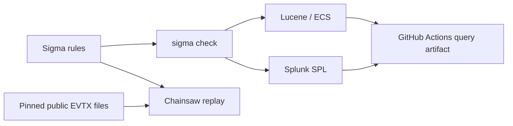

# Sigma Detection Rules

This repository treats Windows detection logic as code. Each Sigma rule has a triage guide, and the validation workflow checks rule quality, converts queries for Elasticsearch and Splunk, and hunts pinned public Windows event logs for expected matches.



## Quick start

Use Python 3.13 to match CI.

```sh
python -m pip install -r requirements.txt
sigma check --fail-on-issues rules
sigma convert -t lucene -p ecs_windows rules
sigma convert -t splunk -p splunk_windows rules
```

For replay, download Chainsaw v2.18.0 for your OS from [the official release](https://github.com/WithSecureOpenSource/chainsaw/releases/tag/v2.18.0). Extract it and locate the bundled `mappings/sigma-event-logs-all.yml`. Run the command below after substituting both paths. The script downloads only the pinned EVTX files needed for the test from [EVTX-ATTACK-SAMPLES](https://github.com/sbousseaden/EVTX-ATTACK-SAMPLES/tree/4ceed2f4706daf601c212a8f91c113dd85349a2c). It analyzes them offline and prints rule counts without event contents.

```sh
python scripts/replay.py --chainsaw /path/to/chainsaw --mapping /path/to/sigma-event-logs-all.yml
```

## Repository structure

| Path | Contents |
| --- | --- |
| `rules/` | Sigma YAML |
| `docs/rules/` | Data sources, test cases, false-positive notes and triage |
| `scripts/replay.py` | Public EVTX positive and negative checks |
| `.github/workflows/validate.yml` | Lint, backend conversion, query artifact and replay jobs |
| `docs/verification.txt` | Local validation transcript |

## Verification

[Local verification](docs/verification.txt) records strict Sigma validation, both backend conversions and the Chainsaw assertions. The hosted workflow will run after the repository is published.

## Results

Local rule and replay outputs appear in [the transcript](docs/verification.txt). Live SIEM execution, environment-specific positives and false positives — TODO(user): fill after running.

## Limitations

- Converted queries assume the ECS Windows and Splunk Windows pipelines. Confirm index scope, field names, XML or classic Security sourcetypes and keyword case behavior before operational use.
- Archive replay checks particular samples and field mappings. Positive replay samples cover LSASS access, Startup folder creation and Administrators group membership. The authentication sample is a negative control. Encoded PowerShell and RemoteInteractive auth still need positive validation on representative data.
- A single failed logon is a triage signal. The encoded PowerShell rule covers the listed switch spellings. A suspicious process-access event does not by itself establish a credential dump.

## MITRE ATT&CK mapping

| Technique | Rule and triage guide |
| --- | --- |
| [T1110.001 Password Guessing](https://attack.mitre.org/techniques/T1110/001/) | [Failed Remote Interactive Logon](docs/rules/remote_interactive_logon_failure.md) |
| [T1059.001 PowerShell](https://attack.mitre.org/techniques/T1059/001/) | [Encoded PowerShell argument](docs/rules/powershell_encoded_argument.md) |
| [T1003.001 LSASS Memory](https://attack.mitre.org/techniques/T1003/001/) | [Read access to LSASS](docs/rules/lsass_process_access.md) |
| [T1547.001 Registry Run Keys / Startup Folder](https://attack.mitre.org/techniques/T1547/001/) | [File creation in Startup](docs/rules/startup_folder_file_creation.md) |
| [T1098.007 Additional Local or Domain Groups](https://attack.mitre.org/techniques/T1098/007/) | [Administrators membership change](docs/rules/local_administrators_member_added.md) |
